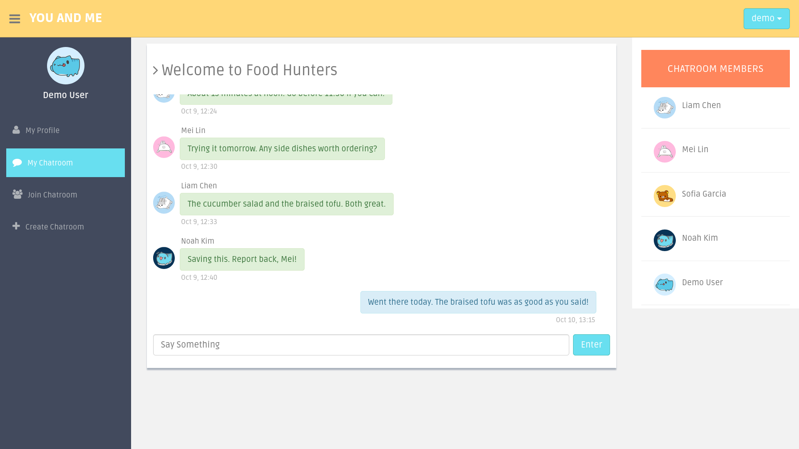
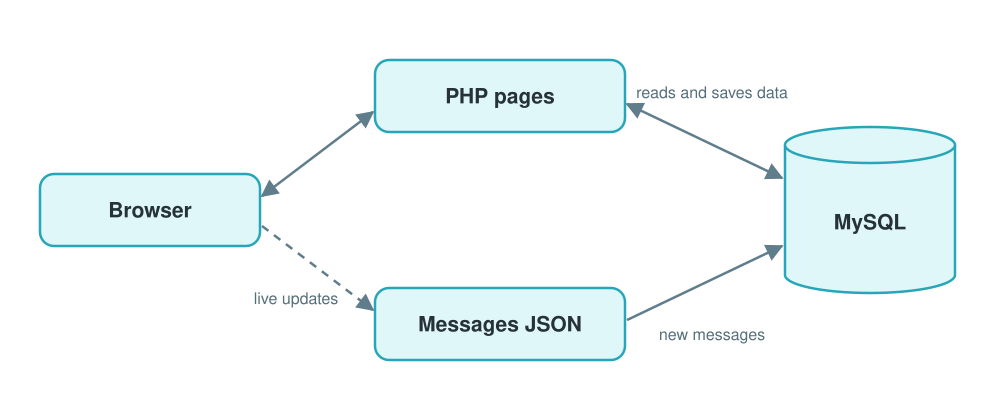
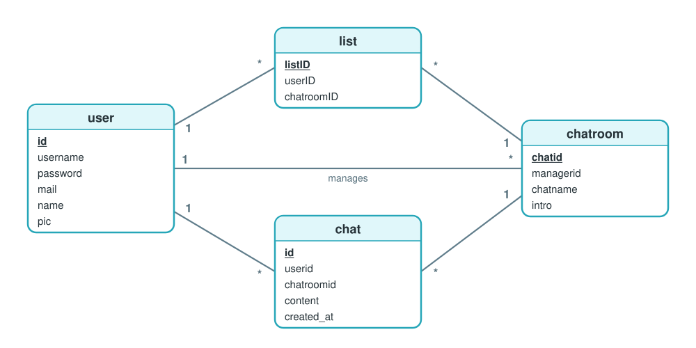

# You and Me

A real-time chat app for meeting people through topic rooms.

🔗 **Live demo:** https://youandme-app.onrender.com

🔑 **Demo account:** `demo` / `youandme-demo`

🎓 **Background:** Team final project for Database Management, National Yang Ming Chiao Tung University, spring 2017



---

## Features

- **My Profile** — update your display name, avatar and password
- **Join Chatroom** — browse open rooms and join any that interest you
- **Create Chatroom** — open a new room with a name and an introduction
- **My Chatroom** — find every room you have joined in one place
- **Chatroom** — chat in real time, with new messages and members appearing live

---

## How It Works



---

## Data Model



Users and rooms are linked three ways: `list` records who joined which room, `chat` holds every message with its sender and room, and each room has one manager.

---

## Security

The live demo is public, so the code covers the main OWASP Top 10 risks:

- **SQL injection** — every query that takes user input is a prepared statement
- **Cross-site scripting** — everything users type is escaped before it appears on a page
- **Cross-site request forgery** — every form carries a secret token that the server checks
- **Snooping on rooms** — only a room's members can open it, read its messages or post in it
- **Stolen passwords** — passwords are stored only as bcrypt hashes
- **Session hijacking** — scripts can't read the session cookie, other sites can't post with it, it travels only over HTTPS, and the session ID changes at login
- **Security misconfiguration** — only `public/` is served, error details go only to the server log, and the database connection is encrypted with a verified certificate

---

## Tech Stack

| Layer | Tools |
|---|---|
| Backend | PHP 8.2, PDO, Apache |
| Database | MySQL 8.4 on Aiven |
| Frontend | Bootstrap 3, jQuery, Fetch API |
| Hosting | Render, Docker |

---

## Running Locally

Requires Docker.

```bash
git clone https://github.com/cassielo/youandme-app.git
cd youandme-app
docker compose up --build
```

Then open http://localhost:8000.

---

## Project Structure

```
public/              web root: pages, form handlers, a JSON endpoint for live updates, assets
includes/            database connection and helpers, session, CSRF, login check, shared chatroom parts
Dockerfile           web server image: Apache and PHP
docker/              PHP settings
youandme.sql         database schema and sample data
docker-compose.yml   local setup: web, MySQL, Adminer
render.yaml          Render deployment config
docs/                README images and diagrams
```
